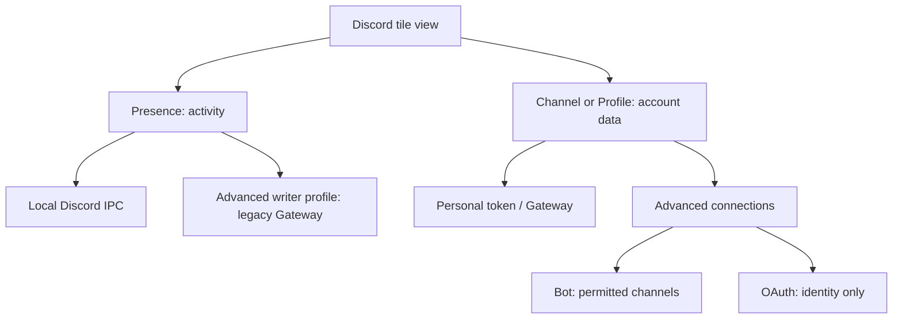

# Discord source menu cleanup

The source menu starts with Presence, Channel, and Profile views. Presence describes
the local Discord IPC writer default and keeps its writer settings together.
Channel and Profile use the separate account reader: its basic connection is the
experimental personal-account Gateway path. Discord's policy warning and policy
guide remain visible. OAuth identity-only access, Bot channel access and disabling
the reader remain under Advanced connections with their capability limits stated.
Selecting a reader connection never selects the
presence writer's backend; the latter still uses `Discord.*` and its advanced INI.

Account/channel, display, click action, and message draft settings remain easy to
reach. Advanced groups account IDs and credential review metadata, cache/counting
and warnings, network timing/limits, and sending permissions. Every reader schema
field remains represented once; acknowledgement and credential revision metadata
are read-only because the account review wizard owns them. Credential entry uses
the existing protected credential action rather than exposing protected data.
All CLI/INI names and accepted backend values remain unchanged.

Choosing Channel or Profile from a factory configuration with no explicit reader
connection stores `UserTokenExperimental` and keeps the reader disabled. The
existing identify/review/connect wizard is still required; selecting a view does
not log in, fetch account data, send a message, or enable presence writes. Every
explicit reader connection, including IPC, is preserved. A guarded INI mutation
rejects the default conversion if another editor saved a connection meanwhile.

Unimplemented RPC/Social SDK values remain accepted for saved configuration
compatibility but are not advertised as working menu methods. Ordinary reader
errors/success use the configured popup notification API. Policy, account and
send reviews use the shared Yes/No notification continuation, with the existing
dialog fallback for classic balloons or unavailable/disabled confirmations.
Credentials and message text still use input windows. Every delayed approval
revalidates the tile/profile/account context; queued approval cannot send or
authenticate automatically. No real account/send test is part of this UX pass.

The primary Desktop tile now shows a disabled `Main tile (cannot remove)` row.
Both removal dispatch and the authoritative, locked INI mutation reject primary
tile removal, including a stale secondary-tile command after a primary change.
Secondary removal retains its existing unpin checks. A separate main-content
selector is follow-up work; this change does not broaden the primary-tile schema
beyond its existing Wallpaper support.

## Which route to use

| Goal | View | Connection | Setup |
| --- | --- | --- | --- |
| Show/publish foreground-window and CPU/RAM activity | Presence | Local Discord IPC by default | Presence writer settings; an advanced writer profile can select its legacy Gateway route. |
| Read a channel's newest message/new items | Channel | Personal account / Gateway | Choose the channel, connect the account, approve the risk and verified identity. |
| Show account profile/available friend/platform data | Profile | Personal account / Gateway | Connect the account; only data actually supplied is shown. |
| Read permitted server channels as a bot | Channel | Advanced connections > Bot | Use a bot credential and its allowed channel, not a personal identity. |
| Show the identity granted by an OAuth token | Profile | Advanced connections > OAuth | Identity-only in this build; not personal inbox/friend access. |

For the requested channel tile: choose **View > Channel messages and new items**,
choose **Account reader connection > Personal account / Gateway**, enter the
channel under **Account and channel**, then **Connect account (enter token and
review)**. Approve the warning notification, enter the token in the masked
window, and approve the verified-account notification. Remember is optional;
unchecked credentials expire when the process stops. Reading does not mark the
channel read. To compose from a click, explicitly allow reviewed sending under
Advanced; compose remains the default click action and requires final review.

The initial blank account tile is replaced by generic connect/setup guidance;
no account ID, token or invented unread count is placed in that placeholder.
